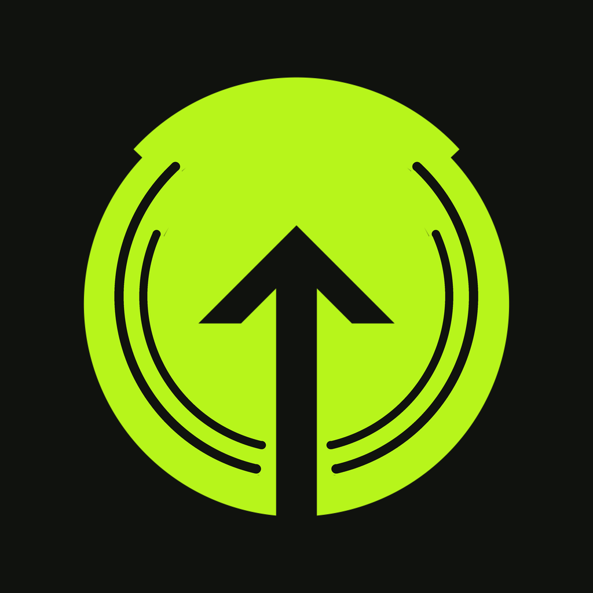
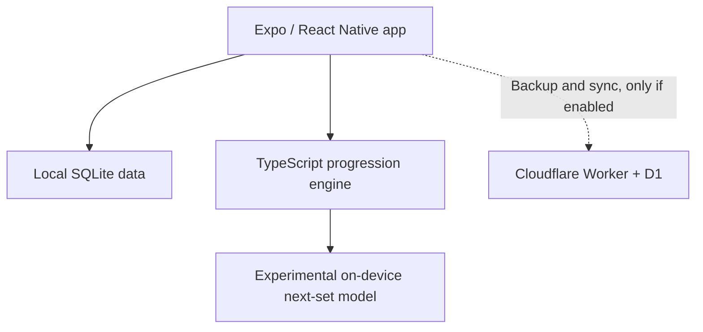

<p align="center">
  
</p>

<h1 align="center">GAIN</h1>

<p align="center"><strong>Your next weight. Ready.</strong></p>

<p align="center">
  An offline-first lifting app that turns the workout you just logged into a clear plan for the next one.
</p>

<p align="center">
  <a href="#the-workout-loop">The workout loop</a> ·
  <a href="#screenshots">Screenshots</a> ·
  <a href="#try-gain">Try GAIN</a> ·
  <a href="#run-the-project">Run the project</a>
</p>

<p align="center">
  <a href="https://github.com/ElMolla10/gain/actions/workflows/ci.yml"></a>
</p>

You already know how to log a set. The harder question is what to do **next time**. GAIN uses your training history, your program and the weights you can actually load to suggest the next target—and shows you why. You can keep it, edit it or ignore it. The decision is always yours.

I built GAIN for the question I kept asking after my own workouts: *what should I load next time, and why?* It is a tool I use, shaped around real sets rather than a generic plan that forgets what happened in the gym.

**Current status:** actively developed and tested, with Android prerelease APKs and local iPhone testing. GAIN is **not on Google Play or the App Store**. The current source (`0.22.0`) is ahead of the most recently published Android APK (`0.21.0`); [Releases](https://github.com/ElMolla10/gain/releases) are test builds, not a build of the latest `main`.

**Pricing:** GAIN is free at launch. There are no subscriptions, in-app purchases, paid feature tiers, ads, or donation prompts in the app. A future business model has not been decided.

## The workout loop

| Before | During | After |
| --- | --- | --- |
| Open your program and see the suggested session, previous performance and targets. | Log sets offline, change an exercise or its order, and use the controls you need without leaving the workout. | See what you did, review the next-session weights and reasons, then accept or adjust them. |

The normal next-session target comes from **versioned, explainable progression rules**. A separate **experimental, on-device model** can suggest an adjustment for an eligible *next set during the current workout*. It does not replace the progression rules or silently change a logged set. Its real-workout accuracy is still being evaluated; predictions are estimates, not a measure of what you can safely lift. [How the rules work](docs/PROGRESSION-RULES.md) · [How live adaptation works](docs/LIVE-ADAPTATION-V2.md)

### Built for the way people actually lift

- **Weights that exist.** Use standard equipment steps or set available weights for an exercise, including dumbbells, barbells and machines. Suggestions respect the configured increments.
- **Your program stays yours.** Edit days, exercises, sets and rep ranges; import Hevy or Strong history, or map columns from another CSV. Review exercise matches before importing.
- **A workout logger, not a spreadsheet.** Working and warm-up sets, supersets, drop sets, notes, a rest timer and mid-workout changes are part of the flow.
- **Progress you can inspect.** History, lift trends, goals and an achievements cabinet draw from workouts you actually logged.
- **Arabic and English.** Both languages are in the app, with right-to-left layout for Arabic; kilograms and pounds, light and dark themes are supported.
- **Your data stays available.** Logging works without an account or connection. Export a full JSON backup or sets as CSV. Cloud backup and sync are optional and off until enabled.

## Screenshots

**Real device captures are coming.** These slots deliberately do not use the web-rendered design images in `docs/design-screens/`: those are useful layout checks, but they are not screenshots of a release build on a phone.

| 01 · Today | 02 · Workout | 03 · Finish |
| :---: | :---: | :---: |
| **Screenshot needed**<br />Suggested session and next target | **Screenshot needed**<br />Logging a set and seeing the next action | **Screenshot needed**<br />Completed workout and next-session plan |

| 04 · Achievements | 05 · Arabic |
| :---: | :---: |
| **Screenshot needed**<br />Trophy Cabinet and progress | **Screenshot needed**<br />A right-to-left workout or Today screen |

**Screenshot handoff:** send five portrait captures from the same recent iPhone build, ideally with sample workouts and no personal training, account or recovery information visible. Dark theme for the first four and an Arabic capture for the fifth would show the product best. Once supplied, add them under `docs/screenshots/` and replace the five slots above with images and descriptive alt text. [The iOS capture plan](docs/IOS-STORE-METADATA.md#screenshot-capture-plan) has the release-specific checklist.

## Try GAIN

| Platform | Available route | What to know |
| --- | --- | --- |
| Android | Download a signed arm64 **prerelease** from [GitHub Releases](https://github.com/ElMolla10/gain/releases). | The last published APK is `0.21.0`; current source is newer. Back up your data before changing builds and do not uninstall an existing copy to update. [Install guide](docs/INSTALL-GUIDE.md) |
| iPhone | Build and install locally from this repository on a Mac with Xcode. | Local iPhone testing is underway. There is no public TestFlight or App Store download yet. [iOS setup](docs/IOS.md) · [Release status](docs/IOS-RELEASE.md) |

The suggested weights are training aids, not medical or coaching advice. Stop if you experience pain or dizziness, and choose loads using your own judgment.

## How it is built



| Part | Responsibility |
| --- | --- |
| [`apps/mobile`](apps/mobile) | iOS and Android UI, local database, import/export, workouts and on-device inference |
| [`packages/engine`](packages/engine) | Pure TypeScript progression rules, load selection, achievements, imports and experimental inference |
| [`packages/sync`](packages/sync) | Shared client/server sync protocol |
| [`apps/server`](apps/server) | Optional Cloudflare Worker + D1 backup, recovery and private coach-card links |

The phone's SQLite database is the local source of truth. Optional sync is a separate action; sharing a coach card as a link also explicitly uploads that card. The live model is bundled with the app and does not call a remote AI service. [Data flows and limitations](docs/SYNC.md) · [Privacy draft](docs/PRIVACY-POLICY-DRAFT.md)

## Run the project

Use **Node.js 22 or newer**. This is an npm workspace; install from the repository root.

```bash
git clone https://github.com/ElMolla10/gain.git
cd gain
npm ci
npm run typecheck
npm test
```

To run the mobile app, use an Android emulator/device with the Android toolchain, or a Mac with Xcode for iOS:

```bash
npm run android -w @gain/mobile
# or, on macOS with Xcode:
scripts/ios-setup.sh --check
scripts/ios-setup.sh --run
```

The iOS helper checks the Mac, generates the native project and installs a local build; it does **not** upload to TestFlight. For a JS bundle check without a device:

```bash
npm run export:android -w @gain/mobile
npm run export:ios -w @gain/mobile
```

CI runs workspace typechecks and tests, Android and iOS JS exports, and an iOS project-configuration check on Linux. Those checks do not substitute for a native iPhone/Android run. Android signing and release steps are in the [release process](docs/RELEASE-PROCESS.md); iOS validation and remaining submission work are in the [iOS release guide](docs/IOS-RELEASE.md).

## Project notes

- [Product direction](docs/PRODUCT.md) · [Planning history](docs/ROADMAP.md) · [Release history](docs/RELEASE-HISTORY.md)
- [Progression rules](docs/PROGRESSION-RULES.md) · [Experimental model and validation limits](docs/LIVE-ADAPTATION-V2.md)
- [Offline behavior](docs/OFFLINE-SAFETY.md) · [Optional sync](docs/SYNC.md) · [iOS setup](docs/IOS.md)

Found a bug or a confusing weight suggestion? [Open an issue](https://github.com/ElMolla10/gain/issues/new/choose) with the steps, app version and expected result. **Do not attach a personal workout export, recovery code or health details to a public issue.**
