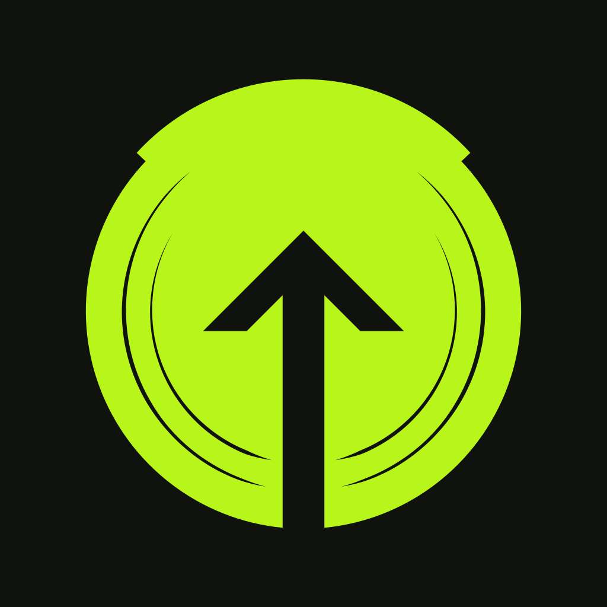
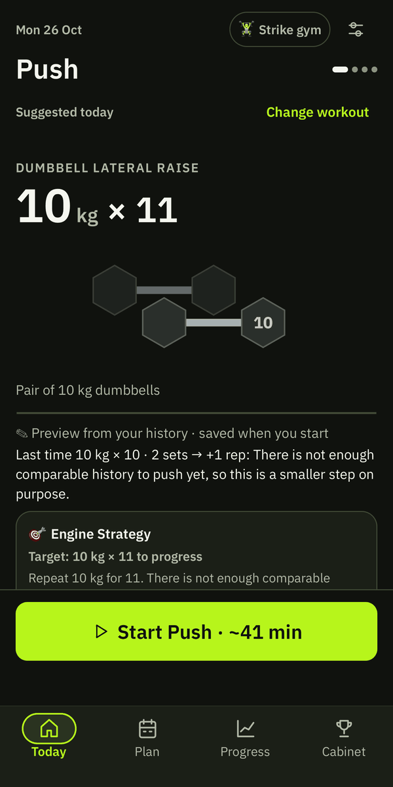
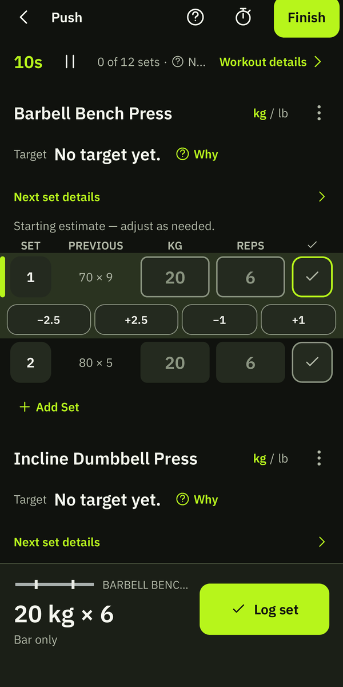
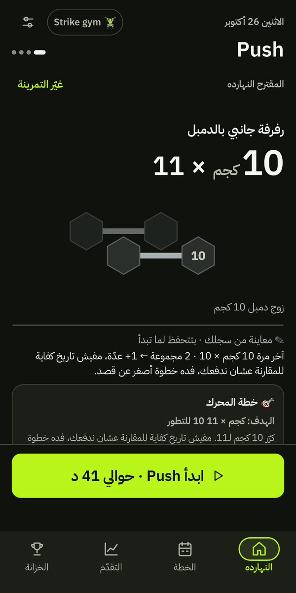
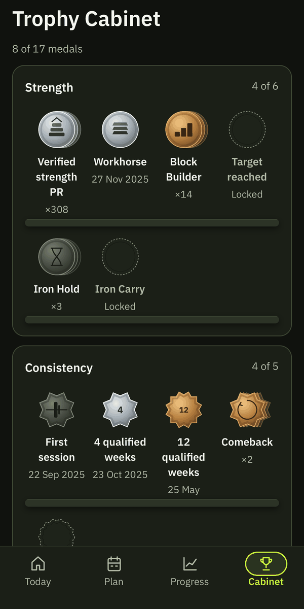
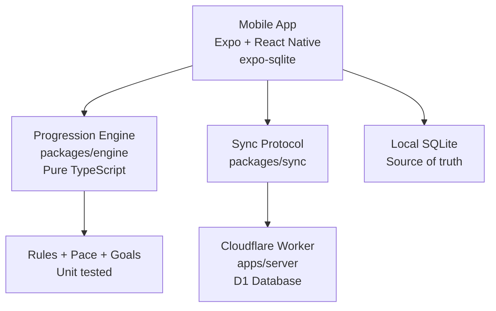

# GAIN

<p align="center">
  
</p>

<p align="center">
  <strong>Leave knowing the next weight.<br>Come back knowing if the goal is still on pace.</strong>
</p>

<p align="center">
  
  
  
  
  
  
</p>

<table align="center">
  <tr>
    <td align="center"><br><sub>Today</sub></td>
    <td align="center"><br><sub>Logging</sub></td>
    <td align="center"><br><sub>Arabic RTL</sub></td>
    <td align="center"><br><sub>Trophy Cabinet</sub></td>
  </tr>
</table>

<p align="center">
  <em>An Arabic + English lifting app that ends every workout by deciding the next one.</em>
</p>

---

GAIN writes your next session **before you leave the gym**.

You finish a set of work. The app already has the next targets: the exercise, the load you can actually put on the bar or dumbbells in *this* gym, the reps, and the reason. Over weeks it tracks whether you're still on pace for a goal you named yourself — 100 kg bench, a bodyweight target, a muscle you want more of — and tells you in one line.

No dashboards. No invented history. No medical advice. Just the next number, explained, and tied to something you actually care about.

**Built for people who already train.** Your split. Your history. Your gym's plates and racks.

---

## Screenshots

<!-- 
  PLACEHOLDERS — please replace these with real screenshots from the app.
  Recommended captures (Android, both Arabic and English if possible):
  1. Today screen (session + one-line pace)
  2. Active workout logger (target + last performance + large controls)
  3. Finish screen (next session draft ready to accept/edit)
  4. Why / decision log (the visible reason for a target)
  5. Goals + pace
  6. Arabic RTL layout example
-->

<p align="center">
  
  &nbsp;&nbsp;
  
  &nbsp;&nbsp;
  
</p>

<p align="center">
  
  &nbsp;&nbsp;
  
  &nbsp;&nbsp;
  
</p>

---

## Why GAIN

Most lifting apps are either a notebook (you still decide the next weight) or a program generator (you fight the program it invented).

GAIN does one job extremely well:

> On the program you already run, the next load is a weight you can actually load, decided from your history, explained, and tied to a dated goal.

It is Arabic-first (RTL, Egyptian gym aliases), gym-aware (it will never ask for 21 kg dumbbells if the rack goes 20 → 22.5), and honest (missing data is said out loud; nothing is invented).

Switching is cheap: Hevy and Strong history import on day one. Continuity is the product.

---

## Features

- **Next session written at the door** — Finish a workout and the next one is already there. Accept, edit a load, or swap an exercise before you leave.
- **Gym-aware loads** — Respects real plate increments, dumbbell steps, cable/machine jumps, and assisted machines. No imaginary weights.
- **Progression currency** — Load is not the only way to progress. The app can spend more reps, higher effort, or quality changes (pause, tempo) before jumping the weight — and it tells you which currency it spent.
- **Rejection memory** — Reject a jump and the app stops nagging you with the same proposal.
- **Visible reasons** — Every target comes with a decision log. You can see exactly why the number is what it is.
- **Goal pace, one line** — Named goals (lift or bodyweight). The app tracks exposures, not just the calendar, and tells you if you're on pace.
- **Short-week rebuild** — "I only have 3 days" or "35 minutes" rebuilds around your goal lifts instead of destroying the plan.
- **Weekly one-decision review** — One screen, one choice: keep, small change, or easier week.
- **Arabic first-class** — Full RTL, bilingual search, local exercise aliases. Not a translated skin.
- **Offline-first** — Everything lives on the device (SQLite). Optional sync later. No invented history. Your data is always yours.
- **Experimental live suggestions** — Offline XGBoost model for optional next-set recommendations (clearly labeled, local-only, never overrides manual loads).
- **Completely free at launch** — No subscriptions, no IAPs, no ads, no donation prompts. Every feature for everyone.

---

## How progression works

A simple rule calculates the number. A model (experimental, offline) only helps on low-confidence cases. Nothing changes the plan until you accept it.

When a normal load jump isn't available or keeps getting rejected, GAIN spends progression in this order:

1. More reps inside the range
2. Same reps at a harder effort target (if you track it)
3. A small quality change (pause, slower eccentric, extra set on a goal lift)
4. Only then the next real load that exists in the gym

You see which currency was spent:  
*"Stay at 30 kg, aim for 12. The next dumbbell is 32.5."*

That sentence is the product.

---

## Architecture



| Package | Responsibility |
|---------|----------------|
| `packages/engine` | Pure TypeScript progression engine. No UI, no DB. Heavily tested. |
| `packages/sync` | Shared sync protocol (app + Worker). |
| `apps/mobile` | Expo + React Native app. Local SQLite is the source of truth. |
| `apps/server` | Optional Cloudflare Worker + D1 for sync and coach links. |

Offline first. Client-generated UUIDs. `updated_at` / `deleted_at` on every row for future sync.

---

## Quick start

**Requirements:** Node 22+, Android device or emulator (for full app).

```bash
git clone https://github.com/ElMolla10/gain.git
cd gain
npm ci

# Run everything
npm run typecheck
npm test

# Start the mobile app
cd apps/mobile && npx expo start --android
```

**Backtest the engine against real history:**

```bash
npm run backtest:hevy -w @gain/engine
```

Building a signed APK requires JDK 17 + Android SDK. See [docs/RELEASE-PROCESS.md](docs/RELEASE-PROCESS.md).

---

## Status

**Current:** Pre-release (v0.22 preparation). Android-first. Sideloaded APKs only.

- 1,440+ tests pass across engine, sync, mobile, and server.
- Core loop (onboarding → import → log → finish → next target) reported working on a real device by the author.
- Device verification, update-over-install, and real-world model accuracy are **not yet independently verified** in the repo.
- GAIN is free at launch. There are no subscriptions, in-app purchases, paid feature tiers, ads, or donation prompts in the app.

Full honesty, gates, and "what to do now" live in [docs/MASTER-PLAN.md](docs/MASTER-PLAN.md).

---

## Documentation

| Doc | What it is |
|-----|------------|
| [PRODUCT.md](docs/PRODUCT.md) | Full product spec and principles |
| [MASTER-PLAN.md](docs/MASTER-PLAN.md) | Current status, gates, next steps |
| [ROADMAP.md](docs/ROADMAP.md) | One-page roadmap |
| [PROGRESSION-RULES.md](docs/PROGRESSION-RULES.md) | How targets are calculated |
| [SYNC.md](docs/SYNC.md) | Optional sync design |
| [RELEASE-HISTORY.md](docs/RELEASE-HISTORY.md) | What shipped, release by release |

---

## Principles

- **Offline first.** Everything is saved locally. Sync is optional.
- **A rule calculates the number.** A model only handles low-confidence cases. Nothing changes until you accept.
- **Missing data is said out loud.** No invented history.
- **Training aid only.** No medical advice, no rehab plans, no form scoring from video.

---

## Contributing

This is currently a personal project by [Mohamed Ehab](https://github.com/ElMolla10). 

PRs are welcome for bug fixes, Arabic corrections, accessibility improvements, and documentation. Feature work is frozen until the pilot is validated (see MASTER-PLAN).

1. Fork the repo
2. Create a branch
3. Run `npm test` and `npm run typecheck`
4. Open a PR against `main`

---

## License

Not yet licensed. All rights reserved by the author for now.

---

<p align="center">
  <strong>GAIN</strong><br>
  Leave knowing the next weight.
</p>

<p align="center">
  <sub>Built in Cairo. Arabic + English. Free at launch.</sub>
</p>
