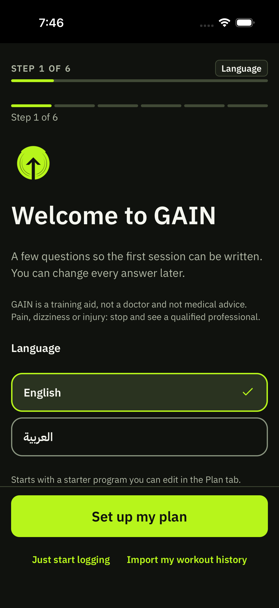

# First-install onboarding: program review before activation

Base inspected: current main `7e2a1ae` (PR #333 included), 2026-11-10. Original main checkout has unrelated untracked QA work and `app.json`; those files are preserved and excluded from this patch. Implementation is isolated on `feat/first-install-program-review`. `apps/mobile/tsconfig.json` is unchanged.

## Current six-step flow, mapped before editing

| Step | Current source and controls | Confirmed beginner friction |
|---|---|---|
| 1 Welcome/language | `OnboardingScreen.tsx`, `language` body and first footer: language radios, Set up my plan, Start logging, Import my workout history | Multiple decisions before the user sees a program; skip enters the existing sample program. |
| 2 Units | `units` body: kg/lb and storage implementation explanation | A full step for a display preference that can be changed later. |
| 3 Training basics | `basics`: days and session minutes | These are needed by the generator. Equipment is not asked. |
| 4 Goal / about you | `goal`: lift target weight/reps/date, bodyweight target, muscle priority or none; optional height/weight/birthday | Detailed targets and personal measurements are not needed to generate the first program. |
| 5 Program choice | `programme`: generated, template or custom. The generator hardcodes hypertrophy, intermediate, all gym equipment, empty avoids. | The beginner's experience and equipment do not control the generated prescription. Preview lists day names and exposure rather than all exercises/prescriptions. |
| 6 Review | `review`: days/time, program name and goal; Finish setup calls `onboarding.complete` | Confirmation does not show the exercises being activated. |

`onboardingForm.ts` defines these six steps. `App.tsx` gates first installs using `onboarding_state`; `markExistingInstall` protects returning installs. Answers and step previously lived only in component state, so restarting lost unfinished setup. These are source-observed defects/friction, not claims from a new native QA run.

## Smallest safe change proposed before editing

Add a first-install-only entry point using the existing generator, shared UI and complete exercise-preview component. Keep setup-again and returning-user routing intact. The first path becomes:

1. Welcome: headline, one review-before-use sentence, exactly one **Build my program** action.
2. Training needs: goal, experience, days, session minutes, available equipment. No training answers are preselected. **Show my program** explicitly generates a draft.
3. Full preview: actual days, exercises and prescriptions. **Use this program** passes that exact draft to the existing onboarding completion repository. **Change my answers** invalidates the preview.

Language, units, avoided exercises, skip-leg preference, import and custom setup are under Other setup options after welcome. Existing Plan/Settings remain accessible after activation. Custom setup retains the old advanced flow, with a cancel action back to the beginner form. No preview generation occurs on welcome, start, restore or answer changes. Draft answers persist in one versioned setting; a restart restores answers, never a silently regenerated preview.

The old hardcoded generation defaults remain in the explicitly requested legacy setup-again/custom flow to preserve its behavior; first-install beginners no longer reach or use them. No progression, library, schema, existing-program or history migration is changed. The selected equipment also shapes the first gym rather than silently assigning full-gym equipment.

## Code verification

- Controller tests: explicit generation only; no guessed answers; exact reviewed draft passed to activation; English/Arabic; persisted draft/restart; invalid/corrupt draft; preview invalidation and stale asynchronous generation; no full-gym fallback; resource/save errors; retry after failed restore/write; duplicate confirmation guard.
- Real Node SQLite tests: first install remains unconfigured and creates no non-sample program before confirmation; saved answers survive a new controller; exact draft equals `loadDraft` after activation; selected gym equipment and done state are persisted.
- Component contracts: English/Arabic welcome has exactly one action and one supporting sentence; preview activation label; mocked 320-point viewport and 1x/1.5x/2x font scales; footer joins scrolling content above 1.3x. Existing preview tests verify English/Arabic exercise rows stack at larger text.
- These are unit/component-tree/SQLite checks, not native pixel-layout, keyboard, actual Dynamic Type, VoiceOver or touch tests.

Final local results: workspace typecheck PASS; full mobile suite **229 files / 2,071 tests PASS**; final iOS JavaScript bundle export PASS. `git -c core.whitespace=cr-at-eol diff --check` PASS (App.tsx retains its existing CRLF line endings). Reproduce:

```sh
npm run typecheck
npm run test -w @gain/mobile -- --maxWorkers=2
```

The local Expo `export:embed --platform ios --dev false --bytecode` check is JavaScript bundle generation only. No new native compilation, EAS distribution build, upload, App Review or release is part of this change.

## Screenshot and simulator evidence: blocked, NOT TESTED

A fresh disposable simulator was created: **GAIN QA FirstInstall 2026-11-10**, UUID `16B748B8-8B13-41AE-92B7-2F1045D98E8B`, iPhone SE (3rd generation), iOS 26.3. No personal simulator was erased or overwritten. Earlier QA devices and their data were retained.

CoreSimulator crashed during first-boot migration. Installation returned `NSMachErrorDomain -308 (server died)` followed by `Unable to lookup in current state: Shutting Down`. Subsequent simctl requests failed with `NSPOSIXErrorDomain 61: Connection refused`. Xcode selection reports `/Applications/Xcode.app/Contents/Developer`, Xcode 27.0 build 27A266a, but `/Applications/Xcode.app/Contents/Developer/Applications/Simulator.app` is absent; `open -a Simulator` also fails. Disk space was checked (initially ~2.1 GiB available, later ~9.9 GiB); no cache/data deletion was performed for this task.

The attempted screenshot contains Apple's simulator boot screen, not GAIN, and is intentionally excluded. **No valid new before/after app screenshots or recordings were obtained.** Browser fallback also failed: CUA reports browser access host unavailable and native service startup failure; required web capture dependencies are absent and npm registry DNS fails. No mockup is presented as an actual app capture.

For historical comparison only, the following **earlier simulator capture from 2026-11-08** shows the old welcome. It is already tracked on main; it is not a new capture or verification of this patch:



Keep this PR draft until the following native checks and after screenshots are completed:

| Path | Code evidence | New simulator / phone |
|---|---|---|
| Clean install, welcome has one action | PASS: English/Arabic component contracts | NOT TESTED |
| Five training inputs, optional settings, full preview | PASS: controller and component contracts; optional paths source-reviewed | NOT TESTED |
| English and Egyptian Arabic RTL | PASS: localized contracts + SQLite save | NOT TESTED: visual RTL, font rendering, language change interaction |
| Narrow screen and larger system text | PASS: mocked 320-point / 1–2x contracts; wrapping/shared screen layout reused | NOT TESTED: actual clipping, keyboard and scrolling |
| Terminate/relaunch mid-setup | PASS: persisted setting restored through a new controller and real SQLite | NOT TESTED: OS process termination |
| Successful Use this program activation | PASS: exact SQLite round trip, no intermediate user program | NOT TESTED: navigation to Today and first workout on native UI |
| Returning installs/history | PASS: existing onboarding tests; first-install gate retained | NOT TESTED on a device with existing data |

## Native follow-up recipe

After restoring a working Xcode Simulator, use only the named disposable device (or another explicitly fresh QA device):

1. Capture clean English welcome at iPhone SE width; assert Build my program is its only actionable control.
2. Tap it. Choose General, Beginner, 3 days, 45 minutes, Dumbbells. Before generation, inspect the QA database: no non-sample program created.
3. Terminate/relaunch. Confirm all five answers return without an activated or regenerated program.
4. Show my program. Scroll every day/exercise/prescription; compare to the saved draft after Use this program. Verify Today opens and restart does not repeat onboarding.
5. On a separate fresh QA sandbox, choose Arabic after welcome; repeat preview/activation. Capture RTL welcome/form/preview at narrow width and large Dynamic Type, including the final confirmation button.
6. Try changing answers, empty equipment, impossible avoids, resource/save errors, optional import/custom/cancel, and opening the keyboard in optional avoids. Confirm errors leave answers/preview available and no confirmation is bypassed.
7. Reopen an existing QA install with workout history and confirm it bypasses onboarding and preserves its active program and sessions.

Physical iPhone testing, VoiceOver speech, keyboard overlap, system Dynamic Type, native RTL visuals, notifications/HealthKit and TestFlight installation remain unverified. This PR must not be merged or uploaded by this task.
