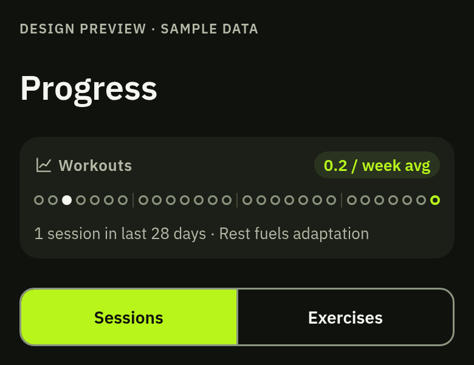
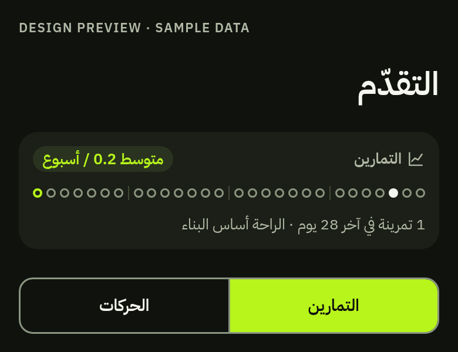

# Progress tab review

These English and Arabic images are **design previews with sample values**, generated in a Linux environment to make the top of the Progress tab reviewable after dropping the Trophy Cabinet and Lifter's Ledger rows. They are not native iOS screenshots. Check the actual device layout, accessibility sizes, and Arabic RTL before shipping.

The Workouts card (formerly Training Rhythm / إيقاع التمرين) keeps its 28-day dots, cadence chip and footnote. The Cabinet and Ledger are opened from the Cabinet tab, not from this screen.

The installed app's values come from the local session history. The previews' example cadence is illustrative.
